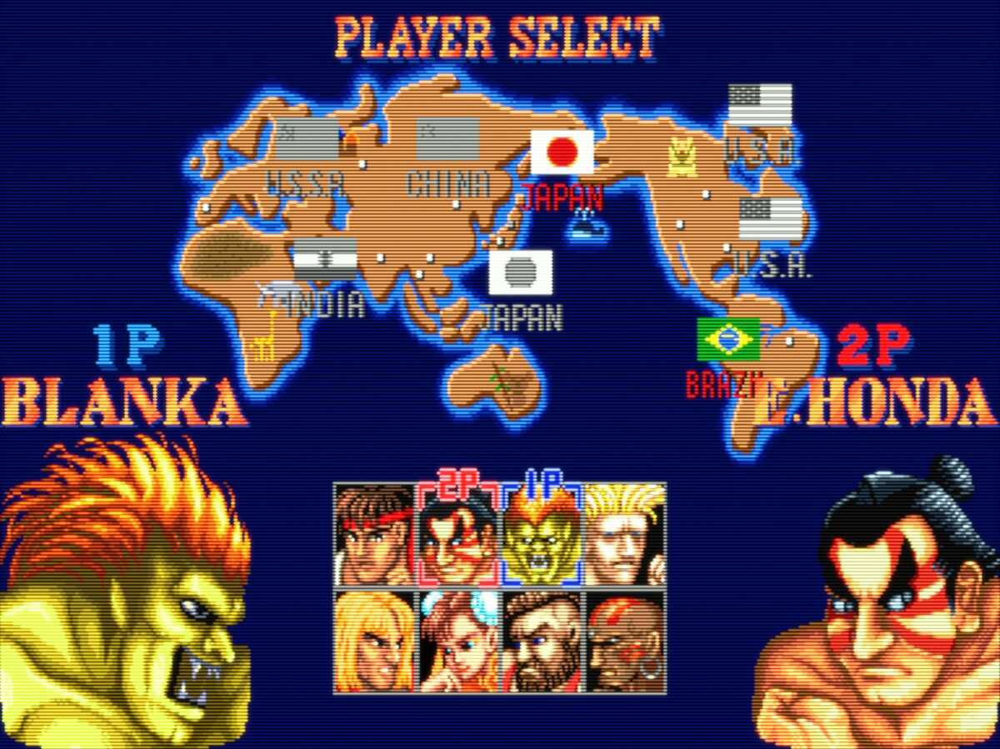
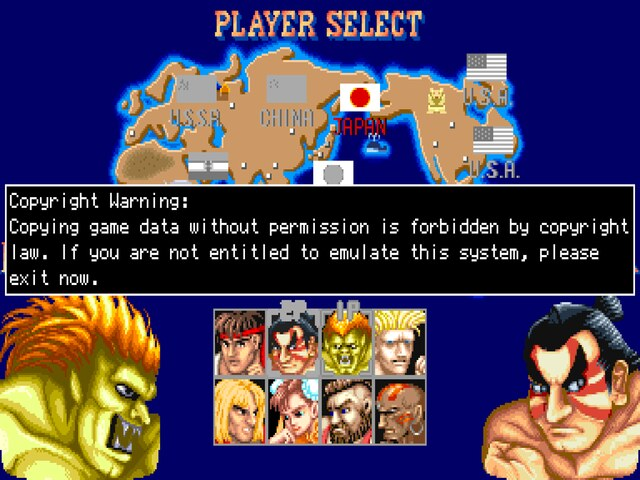
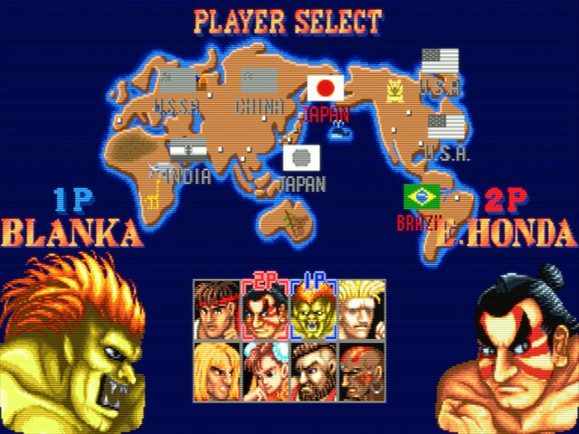
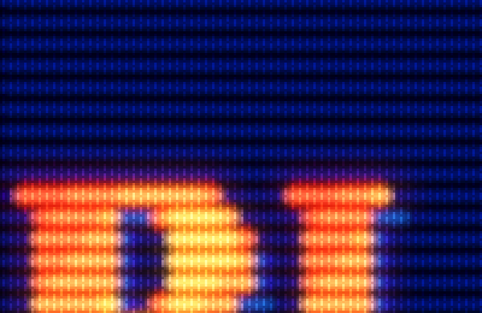
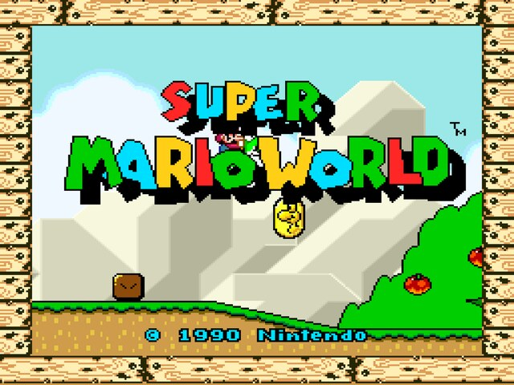
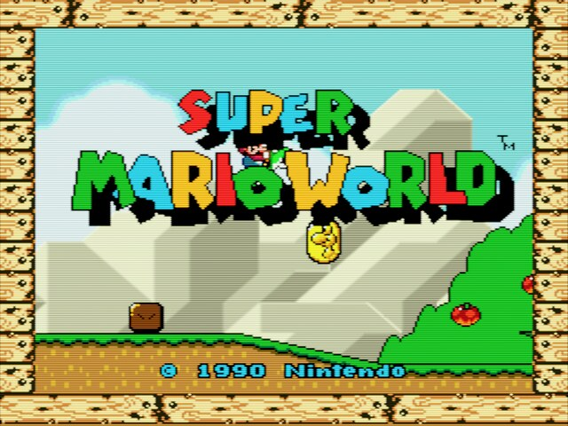
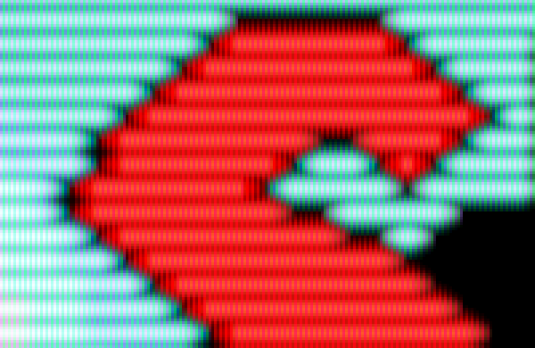

# retroarch-mac-setup

One idempotent script that installs and configures **RetroArch on an Apple Silicon Mac**
(built and tested on a MacBook Air M4, macOS Tahoe 26), driven 100 % by an
game controller: no mouse, no keyboard. Built around an **8BitDo SN30 Pro**; Xbox, PlayStation
and Switch Pro controllers are detected and get the right profile too.



* Native RetroArch (universal build) with **Vulkan through MoltenVK**, never the Metal driver.
* One recommended core per system, chosen for accuracy first (an M4 runs all of them full speed).
* ROM folders renamed to the **libretro-database** names, so folders, playlists and thumbnails all share one name.
* MAME romset analysis against each core's DAT, with **per-game core routing** (mame2010 + mame2003-plus).
* CRT shaders tuned on the M4's own panel: **arcade slot mask** for MAME/Neo Geo, **Sony Trinitron aperture grille** for TV consoles, dot-matrix LCD for handhelds. No curvature.
* Pixel-art menu font (Pixelify Sans, SIL OFL 1.1).
* **Gameplay snapshots only** (libretro-thumbnails `Named_Snaps`), normalized to one canvas size.
* Permanent cache on the external disk: after a reformat, it works **offline**.

## What it looks like

Captured on a MacBook Air M4 at normal brightness, from the same frame with and without the
shader, and shrunk the way macOS shrinks RetroArch's picture for the panel (so this is what the
screen shows). The close-ups are the shader's own output, magnified 3× with no smoothing, so
the phosphor structure is visible on GitHub.

| | Raw pixels | This setup | Phosphor close-up |
|---|---|---|---|
| **Arcade** (MAME, `crt-arcade`) |  |  |  |
| **SNES** (and every TV console, `crt-console`) |  |  |  |

* **Arcade: slot mask**, the phosphor structure of the arcade monitors of the 90s (Nanao,
  Toshiba, Hantarex): staggered phosphor cells, deep scanlines, rich colours and a soft glow.
* **TV consoles: aperture grille**, the continuous vertical red-green-blue phosphor stripes of a
  **Sony Trinitron** TV, the screen most of these games were played on at home.

Both looks were chosen by comparing four candidates on the same frames, on this panel; see
[Shaders](#shaders-one-preset-per-system) for the details.

## Disk layout

Everything the script needs lives in two places on the external disk:

```
/Volumes/BACKUP/
├── roms/                      your games (folders named after libretro-database systems)
│   └── _no_snapshot/<system>/ ROMs without a gameplay snapshot (moved, never deleted)
├── bios/                      BIOS files (you put them here; RetroArch "system" directory)
├── retroarch-saves/           saves/, states/, screenshots/
└── retroarch-cache/
    ├── installer/             RetroArch_Metal-<version>.dmg (offline install)
    ├── cores/                 *_libretro.dylib.zip + info.zip
    ├── shaders/               shaders_slang.zip + presets/
    ├── dats/                  libretro-database DATs and MAME XML lists (CRC identification)
    ├── thumbnails/
    │   ├── originals/<system>/Named_Snaps/    untouched downloads
    │   ├── normalized/<system>/Named_Snaps/   what RetroArch reads
    │   └── index/                             server listings
    ├── tools/python/          portable CPython (works without Command Line Tools)
    ├── reports/<timestamp>/   reports of every run
    ├── rename-log.tsv         folder rename log (used by undo-rename.sh)
    └── manifest.json          what is cached, per system/game, and ROMs known to have no snapshot
```

## Quick start

```bash
git clone <this repo> retroarch-mac-setup
cd retroarch-mac-setup
./setup.sh
```

The script stops with a clear message if `/Volumes/BACKUP` is not mounted. It asks before
it renames folders, moves ROMs or replaces a non-native RetroArch. You can run it as many
times as you like. To add a system, drop a new folder into `/Volumes/BACKUP/roms` (an ES-DE
short name such as `n64` works) and run it again.

| Option | Effect |
|---|---|
| `--refresh-missing` | Searches again online for ROMs marked "no snapshot" and offers to move back the ones that now have one |
| `--update` | Re-downloads RetroArch, cores, shaders and DATs even if they are cached |
| `--offline` | Never touches the network |
| `--canvas 1280x960` | Changes the thumbnail canvas. Everything is rebuilt from `originals/` with no downloads |
| `--renormalize` | Rebuilds every normalized thumbnail from `originals/` |
| `--controller nintendo\|standard\|auto` | Forces the controller profile (see [Other controllers](#other-controllers)); it is remembered. `auto` goes back to detecting it |
| `--check-paths` | Only checks that saves, states, screenshots and BIOS in `retroarch.cfg` point to the disk, and puts them back if not (see [Troubleshooting](#troubleshooting-buttons-or-saves-suddenly-wrong)). Takes a second |

## What the script does, in order

1. **Folders.** Detects the system folders and proposes renames from ES-DE to libretro names,
   showing the full table and waiting for your confirmation. Only folders are renamed. If the
   target folder already exists, the contents are merged only when no file exists in both;
   otherwise you get a warning and nothing is touched. Every change is logged in
   `rename-log.tsv`, and `./undo-rename.sh` reverts them. Folders that are not in
   `systems.json` are reported and skipped. `_no_snapshot` and `_*` folders are ignored.
2. **RetroArch.** Installs the build used by the Homebrew cask **`retroarch-metal`**. Despite
   the name, it is the universal (arm64) build, and it bundles MoltenVK plus the `vulkan`
   and `glcore` drivers. The cask `retroarch` is the x86_64 OpenGL build that runs under
   Rosetta, so it is not used. The DMG is kept in the cache and its SHA-256 is checked against
   the cask. The script also checks that the installed app contains the Vulkan driver.
3. **Cores, info files and shaders.** Downloaded from the libretro buildbot for
   `apple/osx/arm64` and cached. Each core is asked its `library_name`, which is the name
   RetroArch uses for override folders.
4. **Configuration.** Merges `config/retroarch.base.cfg` into
   `~/Library/Application Support/RetroArch/config/retroarch.cfg`; your other settings are
   kept. Before that it checks that saves, states, screenshots and BIOS still point to the
   disk, and rescues anything RetroArch saved elsewhere meanwhile (see
   [Troubleshooting](#troubleshooting-buttons-or-saves-suddenly-wrong)). It also writes per-core overrides and options, a 4:3 override and a shader preset per
   system folder. RetroArch never changes the screen resolution or scaling of the desktop.
5. **BIOS.** Checks the BIOS files with MD5 hashes taken from libretro's `System.dat` and
   the core `.info` files. It tells you which ones are missing and where they go. Nothing is
   ever downloaded.
6. **Thumbnails.** Identifies each ROM by CRC against the libretro-database DAT, then looks
   up its gameplay snapshot on thumbnails.libretro.com. The lookup tries these matches in order:
   1. the exact name
   2. the name without trailing tags
   3. the same title with any region or revision
   4. a match that ignores punctuation, and treats 4 and IV as equal
   5. an alternate title ("Senjou no Ookami II ~ Mercs")
   6. the main title without the subtitle

   For MAME it uses the full name from the DAT (`sf2` → *Street Fighter II: The World Warrior
   (World 910522)*), then the parent set's name. Downloads go to `originals/`, and the
   normalized copy to `normalized/`.
7. **ROMs without a snapshot.** Shows how many would be moved per system and waits for your
   confirmation. They are moved to `roms/_no_snapshot/<system>/`, left out of the playlist and
   listed in `_no_snapshot/_report.txt`. They are never deleted. MAME parent sets that clones
   need are never moved; they are only hidden from the playlist.
8. **Playlists.** One per system, with each entry pointing at its own core.
9. **Reports.** Written to `retroarch-cache/reports/<timestamp>/`: summary, MAME, BIOS,
   no-snapshot, unknown folders and anything still pending download.

## Controller

The script looks at the game controllers macOS knows (paired over Bluetooth, even if switched
off, or plugged in over USB) and installs one of two profiles as
`autoconfig/mfi/MFi_Controller.cfg`:

| Profile | For | Detected by |
|---|---|---|
| `nintendo` | 8BitDo SN30 Pro in Switch mode, Switch Pro Controller, other Nintendo-lettered pads | Nintendo vendor ID (0x057E) |
| `standard` | Xbox, PlayStation and every other pad (RetroArch's stock profile) | anything else |

Only one profile can be active, because RetroArch's `mfi` driver (the default on macOS)
presents every pad as *"mFi Controller"*, with no vendor or product ID. A connected pad wins
over one that is only paired; if pads of both kinds are connected, the script asks. The choice
is remembered, so running the script with the pad switched off keeps it. Pair the controller
**before** the first `./setup.sh`; otherwise it picks `standard` and says so.

### 8BitDo SN30 Pro: pairing mode

Use **Switch mode**, the mode every mapping in this project was tested with (the Mac lists
the pad as **"Pro Controller"**):

1. Hold **START + Y** to turn the controller on (Switch mode).
2. Hold the **pair** button for 3 s. The LEDs start rotating.
3. On the Mac, open *System Settings → Bluetooth* and connect **"Pro Controller"**.
4. From then on, pressing **START** reconnects it. Over a USB-C cable it also works, and it is
   detected as the same "Pro Controller".

Apple's GameController framework supports the Switch Pro Controller natively. RetroArch reads
it with its `mfi` joypad driver (the default on macOS), which exposes every such pad as
*"mFi Controller"*. In this mode the pad reports each face button by the **letter printed on
it** (Nintendo layout: A right, B bottom, Y left, X top); this was checked by logging the
buttons through the same GameController API RetroArch uses. The stock RetroArch profile
assumes Xbox-style pads where A is the bottom button, so with it A and B, and X and Y, come out
swapped. The project's `nintendo` profile (`config/autoconfig/mfi/nintendo.cfg`) maps every printed
letter to the RetroPad button with the same letter. That is the Super Nintendo layout, so on
SNES **B jumps and Y runs**, as on the original pad.

Avoid the other modes (macOS START+A, X-input START+X, D-input START+B): they report other
names and may report the buttons by position instead of by letter, which would swap them.

### Other controllers

Xbox and PlayStation pads need no special mode: pair them in *System Settings → Bluetooth*
(Xbox: hold the pair button on top; PlayStation: hold **Create/Share + PS**) and run
`./setup.sh`. With the `standard` profile every button sends the RetroPad button **in the same
position**, so games play exactly as on the SN30 Pro. In the tables below, read the SNES
letters as positions:

| Below | Position | Xbox | PlayStation |
|---|---|---|---|
| **B** | bottom | A | Cross |
| **A** | right | B | Circle |
| **Y** | left | X | Square |
| **X** | top | Y | Triangle |

Hotkeys are the exception: they follow the label macOS gives the button, so on an Xbox pad
"L2 + A" is the button printed **A** (bottom), and on PlayStation A = Cross, B = Circle,
X = Square, Y = Triangle.

If the detection gets it wrong (A and B swapped in the menu and in games), force the profile
with `./setup.sh --controller standard` or `--controller nintendo`; `--controller auto`
returns to detection.

### Button map

Letters are the SN30 Pro's (SNES layout); on Xbox/PlayStation read them as positions, see
[Other controllers](#other-controllers). L3/R3 = pressing the sticks.
**L2 is the hotkey button**: hold it, then press the second button.

| In menus | Button |
|---|---|
| Move | D-pad / left stick |
| Confirm / Back | A / B |
| Close the menu, back to the game | **L2 + Start** |

| Hotkeys (hold **L2**) | Action |
|---|---|
| L2 + **Start** | Open / close the menu |
| L2 + **R2** (hold) | Fast forward |
| L2 + **R** | Save state |
| L2 + **L** | Load state |
| L2 + D-pad **← / →** | Previous / next state slot |
| L2 + **Select** | Close the game (back to the game list) |
| L2 + **A** | Pause / resume |
| L2 + **Y** | Screenshot |
| L2 + D-pad **↑** | Shader on/off (compare CRT vs. raw pixels) |
| L2 + D-pad **↓** | Reset the game |
| L2 + **X** (press twice) | Quit RetroArch |

| Arcade (MAME) | Button |
|---|---|
| Insert coin | **Select** |
| Start | **Start** |

MAME games use two layouts, on both MAME cores:

| Button | Every MAME game (Neo Geo: A B C D) | CPS1 / CPS2 / CPS3 (Street Fighter …) |
|---|---|---|
| **Y** | button 1 (Neo Geo A – low punch; fire/attack in most games) | low punch |
| **B** | button 2 (Neo Geo B – low kick; jump in most games) | low kick |
| **X** | button 3 (Neo Geo C – strong punch) | medium punch |
| **A** | button 4 (Neo Geo D – strong kick) | medium kick |
| **R** | button 5 | strong punch |
| **R2** | button 6 | strong kick |
| **L** | button 7 | button 7 |

**How, and why not with RetroArch remaps.** Every layout built from RetroArch button remaps
(the script's, or ones set by hand in *Quick Menu → Controls*) left one or two buttons dead
with RetroArch 1.22.2 and the MAME cores, while games that needed no redirection worked
perfectly. So RetroArch passes the pad through untouched and the buttons are assigned inside
MAME, with the same configuration files MAME's own Tab menu writes
(`retroarch-saves/saves/<core>/<core>/cfg/`); `lib/rasetup/remaps.py` documents the details:

* **MAME 2003-Plus.** `default.cfg` holds the standard layout for every game. Neo Geo and CPS
  games also get a config per game (`<set>.cfg`), which in this MAME version must contain the
  game's exact input port list: Neo Geo games share one (`config/mame/mame2003plus-neogeo-ports.cfg`),
  and the CPS games' lists were written by MAME itself and are kept in
  `config/mame/mame2003plus-ports/`. RetroArch's remap only selects the core's *RetroPad*
  controller type (`config/remaps/MAME 2003-Plus/MAME.rmp`).
* **MAME 2010.** `default.cfg` holds the standard layout; each CPS game gets `<set>.cfg` with
  the CPS layout (built from every CPS button field in MAME 2010's `cps1.c`, `cps2.c`,
  `cps3.c`, kept in `config/mame/mame2010-cps-buttons.json`). MAME 2010 never reads R2, so its
  folder remap sends R2 to L3 (one way, not a swap), which MAME sees as button 8.
* Configs you change later in MAME's own menu are kept; the script only replaces files that
  are untouched or that it wrote itself.
* A CPS clone without its own port list uses its parent's (regional variants share their
  controls; if one differs, MAME ignores the file and the game keeps the standard layout).
  A CPS game with neither needs its list once: start it, close it, and run `./setup.sh`
  again (the script says how many are pending). Until then it uses the standard layout.

While L2 is held, RetroArch blocks all game input (after 5 frames, `input_hotkey_block_delay`),
so hotkeys never leak into the game. The trade-off: games cannot use L2. NES, SNES, Genesis,
Master System, Atari, GBA and arcade games never do; a few PlayStation games do. The Select +
Start combo is disabled, so pressing Coin and Start together in an arcade game cannot open the
menu by accident.

RetroArch opens in fullscreen (`video_fullscreen`, using macOS native fullscreen) with the
Ozone menu ready for the controller.

### Keyboard (searching for games)

RetroArch's default keyboard keys stay active next to the controller:

| Key | In the menu |
|---|---|
| **S** | **Search** the current list: type part of the name, then Enter. In a playlist it filters the games by name (it is the RetroPad X action, *Search*) |
| Arrow keys | Move |
| **X** / **Z** | Confirm / back (RetroPad A / B) |
| **Q** / **W** | Page up / page down (RetroPad L / R) |
| **F1** | Open / close the menu during a game |
| **Esc** (twice) | Quits RetroArch: avoid it while searching |

On the controller the same search is the **X** button in a game list.

> **Only one click is needed, once.** The first time RetroArch reads `/Volumes/BACKUP`,
> macOS asks whether it may access a removable volume. Click **Allow**, or enable it ahead of
> time in *System Settings → Privacy & Security → Files and Folders → RetroArch → Removable
> Volumes*. A permission dialog cannot be answered with the controller.

## Video

* Driver: **Vulkan** (MoltenVK). The Metal driver is never used. When a core misbehaves on
  Vulkan, it gets a **per-core** `video_driver = "glcore"` override in
  `config/<core>/<core>.cfg`; the global driver is not changed. It ships enabled only for
  Mupen64Plus-Next (N64), whose renderers need OpenGL or Vulkan features that MoltenVK does
  not expose. Add `"overrides": {"video_driver": "glcore"}` to a system in `systems.json` if
  you ever need it elsewhere.
* **Integer scaling on the vertical axis** (`video_scale_integer_axis = 0`): every scanline
  gets the same number of physical pixels. The horizontal axis follows the aspect ratio:
  * **TV consoles are shown at 4:3**, like on a television: NES, SNES, Genesis, Master System,
    SG-1000, 32X, Sega CD, Atari 2600/7800, PlayStation, Saturn, N64, PC Engine. This is a
    per-folder override, `config/<core>/<ROM folder name>.cfg` with
    `aspect_ratio_index = "0"`, because one core can serve a TV console and a handheld
    (Genesis Plus GX runs Genesis and Game Gear).
  * **Arcade and handhelds** use the aspect reported by the core (`aspect_ratio_index = 22`,
    `ASPECT_RATIO_CORE`): MAME 4:3 or 3:4 for vertical games, GBA 3:2, Game Boy 10:9.
* Vertical arcade games rotate to their native orientation (`video_allow_rotate`).

### Screen resolution

RetroArch runs fullscreen in your normal desktop mode; the resolution and scaling of macOS are
never changed. In the default scaled Retina modes macOS draws at 2x (for example 3420 × 2224 on
"More Space") and shrinks the result to the 2560 × 1664 panel. The shader presets are tuned for
exactly that: their mask and scanlines were measured on screenshots shrunk the same way.

## Shaders (one preset per system)

All presets are **slang**, which works with both Vulkan and glcore. They are built on the
official `slang-shaders` pack and installed to `<RetroArch>/shaders/retroarch-mac-setup/`.
RetroArch loads them automatically as *folder presets*
(`config/<core>/<ROM folder name>.slangp`), which is how two systems that share Genesis Plus
GX can still use different shaders.

| System | Preset | Based on | Why |
|---|---|---|---|
| NES, SNES, Genesis/Mega Drive, Master System, SG-1000, 32X, Sega CD, Atari, PlayStation, Saturn, PC Engine | `crt-console` | crt-hyllian | Chosen by comparing four candidates on the same frames of Super Mario World and Sonic on the M4 Air (current Guest preset, Trinitron aperture grille, dot mask, NTSC composite): Hyllian's CRT shader with an **aperture grille** (`PHOSPHOR_LAYOUT 1`), the phosphor stripes of Sony Trinitron TVs, at the shader's own defaults otherwise. No curvature. |
| MAME, FBNeo, Neo Geo | `crt-arcade` | crt-hyllian | Chosen by comparing four candidates on the same frame of Street Fighter II on the M4 Air: Hyllian's CRT shader with a **slot mask** (`PHOSPHOR_LAYOUT 12`), the phosphor structure of the arcade monitors of the era (Nanao, Toshiba, Hantarex), at its 4K size so it survives macOS's scaling; rich colours, scanlines with a full beam on bright pixels, brightness compensation (`BRIGHTBOOST 1.45`) and a soft phosphor glow. No curvature. Vertical games keep their scanlines vertical, as on a rotated monitor. |
| Game Boy, GBC, GBA, Game Gear, Lynx, Neo Geo Pocket, WonderSwan | `lcd-dot` | handheld/dot | Soft dot-matrix LCD pixel grid, ~109 % of the unfiltered brightness. No RGB sub-pixel stripes (moiré in the scaled Retina mode) and no "original dull LCD" colour emulation: `gba-color` and Gambatte's GBC colour correction left the picture at ~62 % brightness with washed-out colours, so they are off (`mgba_color_correction = OFF`, `gambatte_gbc_color_correction = disabled`). mGBA's *smart* interframe blending stays on for LCD ghosting effects. |
| N64, Virtual Boy | none | | N64 renders at a higher internal resolution, where CRT masks look wrong. Virtual Boy's red-on-black output needs no shader. |

All of these run at full speed on the M4 with Vulkan. **L2 + ↑** turns the shader off and on
so you can compare. Tune them in *Quick Menu → Shaders → Shader Parameters*: scanline
thickness is `beam_max` (higher = wider dark gaps), mask strength `maskstr`, colour
`wp_saturation`, overall brightness `post_br`.

Why there is no "more brightness" switch: on macOS this RetroArch build has no HDR/EDR output
with Vulkan (the log shows a plain BGRA8888 swapchain), so a shader cannot go brighter than
the desktop's white. The presets pay back most of the dark scanline gaps with brighter lines
and stop at ~90 %, which reads as a CRT rather than a washed-out picture. True Tone (*System Settings → Displays*) warms the white point;
turn it off (and Night Shift) if colours look yellowish.

## Menu and font

The menu driver is **Ozone**, the macOS default. In RetroArch 1.22 Ozone accepts a custom TTF
(`ozone_font`), so it did not need to change. The font is **Pixelify Sans**
(`fonts/PixelifySans-Regular.ttf`, SIL Open Font License 1.1, see `fonts/OFL.txt`), which can
be redistributed. It is also used for on-screen notifications.

## Thumbnails

* Only **Named_Snaps** (gameplay) are shown: `menu_thumbnails = 1`, with
  `menu_left_thumbnails = 0` and `menu_icon_thumbnails = 0`. Box art and title screens are
  disabled, and so is on-demand downloading (`network_on_demand_thumbnails = false`), so
  RetroArch never adds other images.
* Every image has exactly the same size: by default a **960×720 (4:3) canvas** with black
  bars. Snapshots smaller than the canvas get a pixel-perfect integer upscale
  (nearest-neighbour). Larger ones are scaled down to fit. Nothing is cropped or deformed:
  SNES 8:7, GBA 3:2 and vertical arcade games all keep their shape.
* RetroArch reads them **directly from the external disk**
  (`thumbnails_directory = /Volumes/BACKUP/retroarch-cache/thumbnails/normalized`). Ozone
  loads thumbnails asynchronously and each one is a small PNG, so a USB disk adds no visible
  delay. Copying them to the Mac would only duplicate gigabytes of data.
* **Videos in the menu:** RetroArch cannot play video previews in its menu. If you want
  them, the real alternative is a frontend such as **ES-DE** or **Pegasus**, which shows
  video snaps and launches RetroArch cores. That is not implemented here.

## MAME: which core and why

MAME romsets only work with the MAME version they were made for. The script compares the
ROM CRCs of every zip against the full XML list of each core: for mame2010 the one in
libretro-database, for **mame2003-plus the `metadata/mame2003-plus.xml` generated from the
core's own source**. The libretro-database copy for mame2003-plus lags behind the compiled
core: it lists sets the core no longer contains and leaves out ROMs the core requires (CPS2
`.key` decryption files, for example), so games that cannot start ended up in the playlist.
Checked on real launches: sets rejected by the core's list fail with "Required files are
missing" or "Game driver not found", and sets it accepts start. The script checks the parent
and BIOS chain too, and treats alternative BIOS regions as optional, as MAME does. Your
collection contains two romset generations:

* sets that match **mame2010** (MAME 0.139). This includes most of the "MAME 0.152"
  collection; no 0.152 core exists for macOS arm64, and the newer cores (mame2015 = 0.160,
  mame2016 = 0.174) match fewer of these sets.
* older sets that only match **mame2003-plus** (0.78 + backports), which fits the Mame32-era
  collection.

So the MAME playlist mixes cores **per game**. A set goes to mame2010 when it matches there
(mame2010 has the more accurate drivers), and to mame2003-plus when it only matches there.
Zips are never renamed: MAME needs the short names. Playlist labels and thumbnails use the
full game name from the DAT.

* **BIOS and device sets** (`neogeo.zip`, `qsound.zip`, `cpzn1.zip`, …) stay in place but are
  not shown in the playlist.
* **Incompatible sets** stay in place and are left out of the playlist. The MAME report lists
  them with the reason (set newer than the core, missing ROM files, missing parent). It also
  lists the most common blockers: for example, an up-to-date `neogeo.zip` recovers every Neo
  Geo game that fails only because of `sfix.sfix`.
* Sets whose files are all present but where some CRC differs are kept, flagged in the report:
  MAME shows a *WRONG CHECKSUMS* warning and the game still starts.

## BIOS

Put BIOS files in **`/Volumes/BACKUP/bios/`**, the RetroArch *system* directory, with the
exact file name. The script checks them by MD5 and lists what is missing in `bios.txt`.
PlayStation (SwanStation) needs one of these: `scph5501.bin` (US), `scph5500.bin` (JP) or
`scph5502.bin` (EU). Every BIOS the map knows about is listed in `systems.json`.

## Restoring after reformatting the Mac

1. Install macOS, connect the **BACKUP** disk and get this folder back (`git clone`, or copy it).
2. Run `./setup.sh`. **No internet needed.** From the cache on the disk it uses:
   * a portable Python, so no Command Line Tools are needed;
   * the cached RetroArch DMG, installed with `hdiutil` and `ditto`;
   * the cached cores, shaders and DATs;
   * the normalized thumbnails, which are read in place.

   Without internet and without ImageMagick, new thumbnails are normalized with macOS's
   `sips`.
3. Saves, states and BIOS were already on the disk. Playlists are regenerated.
4. Pair the controller again in **Switch mode** (START + Y, as above) and allow access to
   removable volumes once.

With internet, the script also refreshes what is missing, such as snaps for new games and
cores for new systems. Anything it could not download is listed in `pending.txt` and picked
up on the next run.

## Adding systems

`systems.json` already maps about 30 systems (N64, GB/GBC, Game Gear, Sega CD, Saturn,
PC Engine/CD, Neo Geo Pocket, WonderSwan, Lynx, 7800, 32X, FDS, Virtual Boy, FBNeo/Neo Geo…).
For each system it records:

* the libretro name, which is also the folder, playlist and thumbnail name;
* the equivalent **ES-DE short names**;
* the core(s), valid extensions and BIOS files (with MD5);
* the DAT used for CRC identification;
* the shader preset, plus optional per-core `overrides` and `core_options`.

Drop a folder with an ES-DE name (for example `n64`) into `/Volumes/BACKUP/roms` and run the
script. It proposes the rename, with the same confirmation, and integrates the system.

## Troubleshooting: the controller does not respond

1. **Mode.** Turn the pad off (hold START until the LEDs go out), then on again with
   **START + Y** (Switch mode). If it was paired in another mode, remove it from *Bluetooth*
   and pair it again as "Pro Controller".
2. **macOS sees it.** *System Settings → Game Controllers* (or *Bluetooth*) should list it as
   connected. If it is not listed there, the problem is Bluetooth, not RetroArch.
3. **Charge.** Low battery causes random disconnects. Charge it over USB-C (it also works wired).
4. **Driver.** In RetroArch: *Settings → Drivers → Controller* must be **mfi**, and *Settings →
   Input → RetroPad Binds → Port 1 Controls → Device Index* should show *mFi Controller*.
   You can check both with the keyboard arrows and Enter if needed.
5. **Profile.** `~/Library/Application Support/RetroArch/autoconfig/mfi/MFi_Controller.cfg`
   must exist (run `./setup.sh` again to restore it), and `input_autodetect_enable = "true"`
   must be in `retroarch.cfg`. If A/B and X/Y are swapped, the wrong profile is installed:
   run `./setup.sh --controller standard` (Xbox, PlayStation) or `--controller nintendo`
   (SN30 Pro in Switch mode, Switch Pro).
6. **Hotkeys do nothing.** Hold **L2 first**, then press the other button.
   `input_enable_hotkey_btn = "12"` (L2) must be in `retroarch.cfg`.
7. **A button does nothing / does the wrong thing.** *Settings → Input → RetroPad Binds →
   Port 1 Controls* shows what each button is bound to; press the button there to see which
   index RetroArch receives (L2 = 12, R2 = 13, Home = 16). If a button is missing entirely,
   macOS is not passing it on: check it in *System Settings → Game Controllers*, which has its
   own button test. On macOS 26 the **Home** button can be claimed by the system's game
   overlay; that is why the menu is on L2 + Start.
8. **RetroArch overwrote the config.** It saves `retroarch.cfg` when it quits. The script
   refuses to run while RetroArch is open, but if you edited settings in the menu, running
   `./setup.sh` again restores the managed keys.
9. **Firmware.** Old firmware has Bluetooth bugs. Update it with *8BitDo Ultimate Software*
   (Mac/Windows) from support.8bitdo.com.

## Troubleshooting: buttons or saves suddenly wrong

Symptoms: MAME games no longer follow the button layouts (Tumble Pop does not fire with Y or
jump with B, CPS games have the punches in the wrong places), saves or states are missing, or
`~/Documents/RetroArch` has appeared.

Cause: RetroArch was opened while `/Volumes/BACKUP` was not mounted yet, or before macOS gave
it access to removable volumes. When a configured directory does not exist, RetroArch falls
back to its default (`~/Documents/RetroArch/saves`, `.../states`, screenshots `default`), and
because it saves `retroarch.cfg` when it quits, the fallback stays. From then on saves and
states go to the Mac, and the MAME cores read their button layouts (`cfg/default.cfg`,
`cfg/<set>.cfg`, which live in the save directory) from an empty folder, so every MAME game
gets MAME's factory buttons. The controller profile and the remaps are not involved.

Fix: quit RetroArch and run

```bash
./setup.sh --check-paths
```

It lists the directories that point off the disk, copies to the disk every file saved in the
fallback folders meanwhile (it never overwrites a file on the disk; one that differs is listed
and left where it is, for you to choose) and writes the disk paths back. A normal `./setup.sh`
run does the same check. Afterwards `~/Documents/RetroArch` is no longer used and can be
deleted.

To avoid it, connect the disk and wait for it to appear in Finder before opening RetroArch.

## Troubleshooting: RetroArch quits when a MAME game starts

Seen with RetroArch 1.22.2 on macOS: after playing one MAME 2003-Plus game, starting a second
one from a playlist crashed RetroArch (`EXC_BAD_ACCESS` in `cocoa_input_state`, crash report in
`~/Library/Logs/DiagnosticReports/RetroArch-*.ips`). The core stays loaded between the two
games, so it already polls input while the second game loads, before RetroArch has re-created
its input driver; with the core's default `mame2003-plus_xy_device = "mouse"` that poll reads
the (not yet created) mouse/pointer state. The script sets `mame2003-plus_xy_device =
"disabled"` (no MAME game here needs a mouse or light gun with a gamepad) and
`mame2003-plus_input_interface = "retropad"` (the keyboard stays free for searching the menu
instead of triggering MAME's own keys). If a crash ever happens anyway, closing RetroArch and
opening the game first thing in a fresh session avoids it.

## Files

| Path | Purpose |
|---|---|
| `setup.sh` | Entry point: checks the disk, provides Python, runs `lib/main.py` |
| `undo-rename.sh` | Reverts the folder renames and merges recorded in `rename-log.tsv` |
| `systems.json` | System map (folder name, ES-DE names, cores, extensions, BIOS, shader…) |
| `config/retroarch.base.cfg` | Managed `retroarch.cfg` keys (every key checked against RetroArch 1.22.2) |
| `config/autoconfig/mfi/nintendo.cfg`, `standard.cfg` | Controller profiles (one is installed as `MFi_Controller.cfg`) |
| `config/shaders/*.slangp` | Shader presets |
| `fonts/` | Pixelify Sans + licence |
| `lib/rasetup/` | Implementation (Python standard library only) |

## Licences

Code: MIT. Font: SIL OFL 1.1 (Pixelify Sans Project Authors). Shaders, cores, DATs and
thumbnails are downloaded from libretro at run time and are not redistributed here. This
repository never contains ROMs, BIOS files, downloaded images or the cache (see `.gitignore`).
